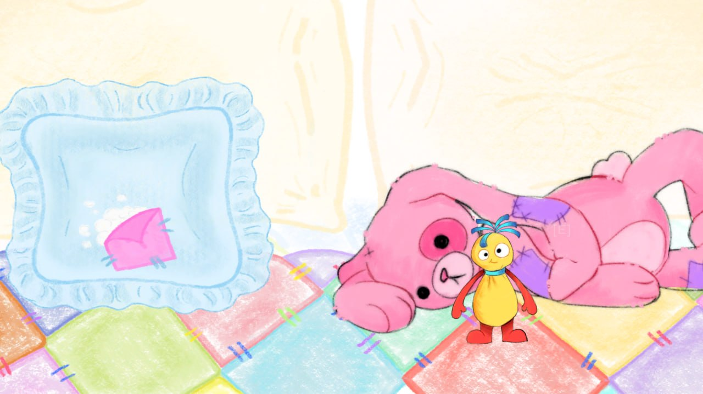
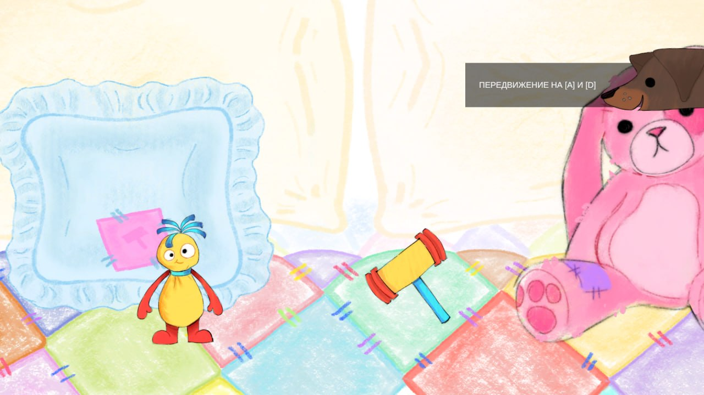
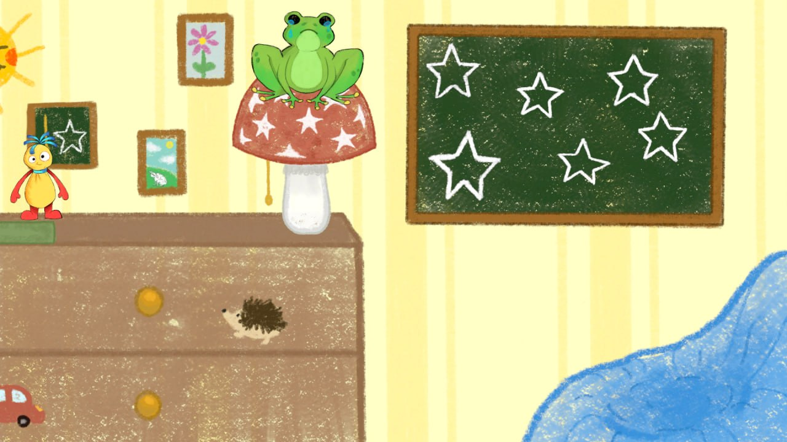
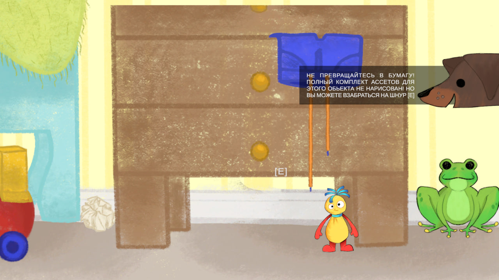
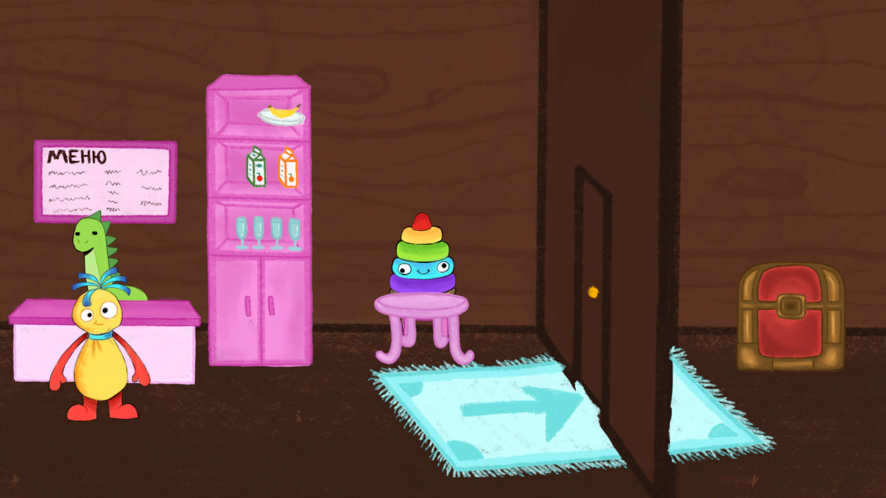

# Рисовашка

**2D-приключение на Unity 6.** Четыре уровня, нарисованный от руки мир и говорящие персонажи.

[](https://github.com/h1deotw/risovashka/releases/latest/download/Risovashka-Windows-x64-v1.0.zip)

### ▶ [Скачать демо (Windows, ~1 ГБ)](https://github.com/h1deotw/risovashka/releases/latest/download/Risovashka-Windows-x64-v1.0.zip)

1. Скачать архив по ссылке выше.
2. Распаковать **в любую папку** (правый клик → «Извлечь все»). Ставить ничего не нужно.
3. Запустить `Рисовашка.exe`.

Если Windows покажет синее окно SmartScreen — «Подробнее» → «Выполнить в любом случае». Это обычное предупреждение для всех новых EXE без подписи.

## Скриншоты

| | |
| --- | --- |
| [](docs/screenshots/01-bear-room.jpg) | [](docs/screenshots/02-movement.jpg) |
| Комната с плюшевым медведем | Обучение: подсказки по управлению |
| [](docs/screenshots/03-frog-blackboard.jpg) | [](docs/screenshots/04-paper-warning.jpg) |
| Лягушка на грибе и доска со звёздами | Подсказка |
| [](docs/screenshots/05-shop-room.jpg) | |
| Комната с меню | |

## Об игре

Игрок исследует нарисованный от руки мир, а подсказки объясняют, что делать дальше. Основной упор — на атмосферу и визуальный стиль.

## Что реализовано

- **Четыре игровых уровня** — `Level_1`, `Level_2`, `Level_3`, `Level_3.1` с разными механиками.
- **Диалоговая система** — реплики персонажей в world-space Canvas, блокировка управления на время диалога, последовательности реплик (`CreatureDialog`).
- **Мини-игры** — цикл состояний мини-игры с собственными правилами и наградой (`MinigameCycle`).
- **Взаимодействие с объектами** — активаторы, подбираемые предметы, верёвки и лазание (`InteractableActivator`, `ClimbRope`, `RopeActivator`).
- **Переходы между уровнями** — порталы с проверкой условий (`LevelPortal`) и сохранение прогресса между сценами (`GameProgress`, `GameState`).
- **Подсказки** — контекстные сообщения рядом с игроком (`SimplePrompt`, `TaksaManager`).
- **Визуальные акценты** — подсветка интерактивных объектов обводкой (`OutlineManager`), затемнения и переходы (`ScreenFader`).
- **Камера** — слежение за игроком на Cinemachine в связке с собственной логикой (`CameraFollowHorizontal`).
- **Меню и пауза** — `MenuManager`, выход по `Esc`.

## Стек

| Что | Версия / пакет |
| --- | --- |
| Unity | 6000.5.5f1 (Unity 6) |
| Рендер | URP 2D 17.5.0 |
| Ввод | Input System 1.19.0 |
| Камера | Cinemachine 3.1.6 |
| 2D | 2D Animation, Tilemap, SpriteShape, Aseprite Importer |
| UI / текст | uGUI, TextMeshPro |
| Анимация сцен | Timeline 1.8.12 |

## Управление

| Клавиша | Действие |
| --- | --- |
| `A` / `D`, `←` / `→` | Движение |
| `E` | Взаимодействие, диалог, портал |
| `T` | Подсказка |
| `Left Ctrl` | Подсветка интерактивных объектов |
| `Esc` | Меню / пауза |
| `Q` | Завершить мини-игру (отладочная клавиша) |

## Запуск из исходников

Открыть папку проекта в Unity **6000.5.5f1**, дождаться импорта и открыть любую сцену из `Assets/Scenes`.

Проект лежит в репозитории целиком — без `Library`, поэтому при первом открытии Unity пересоберёт кеш (это нормально и занимает несколько минут).

## Структура

```
Assets/
  Scenes/        игровые сцены
  Scripts/       весь игровой код на C#
  Prefab/        префабы
  Animations/    анимации и контроллеры
  LVL1, LVL2, 3lvl, DEMO, Persons, Settings   контент уровней
Packages/        зависимости проекта
ProjectSettings/ настройки Unity
docs/screenshots/ скриншоты и гифки
```

## Автор

Учебный проект по разработке игр на Unity.
